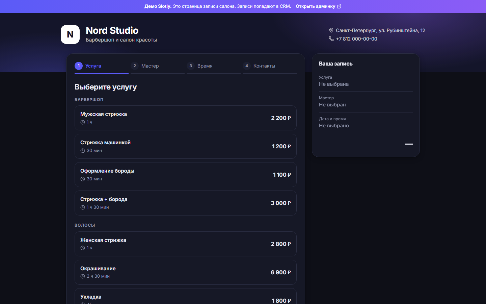
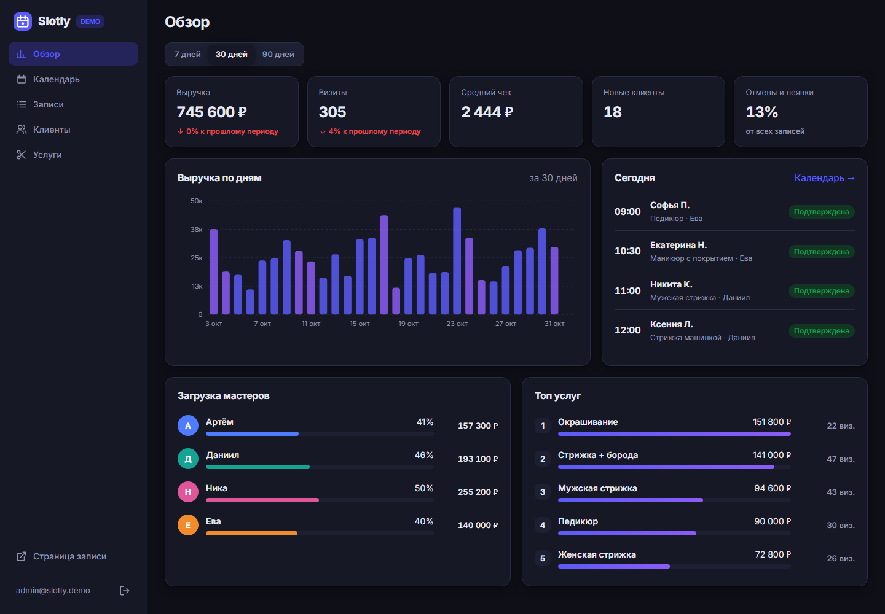
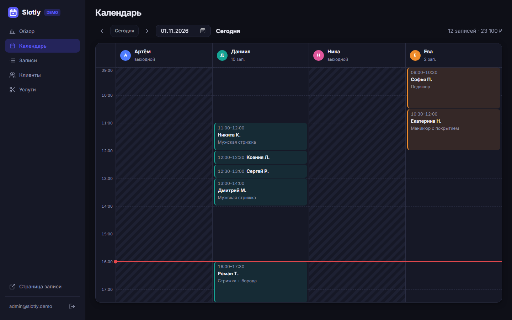

# Slotly: online booking and CRM for salons

[](https://github.com/mallicee/slotly/actions/workflows/ci.yml)

**[▶ Live demo](https://mallicee.github.io/slotly/)** · **[CRM admin](https://mallicee.github.io/slotly/#/admin)** (the demo login fills in automatically)

A full-stack app for barbershops, beauty salons and studios. Clients book themselves online, and the owner sees the schedule, the client base and revenue in the CRM.



## What's inside

**Client booking**
- Service → specialist (or "any") → date → free time → contact details. A summary card stays next to the steps.
- The next 14 days show the number of free slots for each day. Time is grouped into morning, afternoon and evening.
- If someone else takes the time while a client is filling in the form, the server responds with `409`, the client returns to the time picker and sees a message.
- An `.ics` file adds the visit to any calendar app with a reminder 2 hours before.

**CRM for the owner**
- **Overview:** revenue, visits, average check, new clients and the cancellation rate for 7, 30 or 90 days, compared with the previous period. Also a revenue chart (SVG, no libraries), specialist utilisation and the top services.
- **Calendar:** one day across all specialists, days off, a "now" line, status changes from the booking card.
- **Bookings:** filters by period and status, search by client, phone and service.
- **Clients:** the base with LTV, visit count, last and next visit, and a VIP badge.
- **Services:** CRUD. A service that already has bookings goes to the archive so the history is preserved.

| Overview | Calendar |
|---|---|
|  |  |

## Architecture

```
slotly/
├── backend/            FastAPI + SQLAlchemy 2 + JWT
│   ├── app/
│   │   ├── availability.py   slot algorithm (pure functions)
│   │   ├── scheduling.py     working hours, booking rules, double-booking protection
│   │   ├── api.py            public and admin REST API
│   │   ├── auth.py           scrypt password hashes, JWT bearer tokens
│   │   ├── notify.py         Telegram notifications about new bookings
│   │   └── seed.py           demo data: 2 months of history
│   └── tests/                pytest: 38 tests
├── frontend/           React 19 + TypeScript + Vite
│   └── src/
│       ├── api/              Api contract, HTTP client and in-browser demo backend
│       ├── booking/          client booking page
│       ├── admin/            CRM: overview, calendar, bookings, clients, services
│       └── lib/              slot algorithm (TS), formatting, phone mask, .ics
└── shared/
    ├── catalog.json          services, specialists and schedules: one source for both sides
    └── availability-cases.json  shared slot-algorithm tests for Python and TS
```

**Decisions worth noting**

- **One algorithm, two languages, one contract.** Free-slot calculation exists in Python (server) and TypeScript (demo). Both implementations run the same cases from `shared/availability-cases.json`: breaks, buffers, past time, the end of the working day. If they ever diverge, CI fails.
- **The server re-checks the slot** at booking time, inside the transaction, and does not trust the page. With "any specialist" it picks the least loaded free one.
- **The live demo has no server.** GitHub Pages only serves static files, so the frontend talks to the `Api` interface. With `VITE_API_URL` set it uses the HTTP client for FastAPI. Without it, `DemoApi` runs in the browser: same rules, same catalog, data in `localStorage`. The demo history is regenerated daily so the dates always stay current.
- **Prices are never taken from the browser:** the server reads the price from the service.
- **Security:** passwords use scrypt (stdlib), JWT has a TTL, CORS uses an allowlist, and HTML in Telegram notifications is escaped.

## Run locally

**Backend** (Python 3.13):

```bash
cd backend
python -m venv .venv && . .venv/bin/activate   # Windows: .venv\Scripts\activate
pip install -r requirements.txt
cp .env.example .env                           # set SECRET_KEY
uvicorn app.main:app --reload --env-file .env  # http://localhost:8000/docs (Swagger)
pytest                                         # tests
```

**Frontend** (Node 20+):

```bash
cd frontend
npm install
cp .env.example .env.local   # work with the backend; without this file the demo runs
npm run dev                  # http://localhost:5173
npm test && npm run typecheck
```

**Docker** (API):

```bash
docker build -f backend/Dockerfile -t slotly-api .
docker run -p 8000:8000 -e SECRET_KEY=change-me -v slotly-data:/data slotly-api
```

## Telegram notifications

Set `TELEGRAM_BOT_TOKEN` and `TELEGRAM_CHAT_ID` in `.env`. Every new booking then arrives in the chat:

```
🗓 Новая запись
Стрижка + борода · 3000 ₽
04.11 (ср) 12:00–13:30 · мастер Артём
👤 Иван Петров, +79211234567
```

## Stack

Python 3.13 · FastAPI · SQLAlchemy 2 · Pydantic 2 · PyJWT · pytest · React 19 · TypeScript · React Router · Vite · Vitest · GitHub Actions · Docker

---

*Nord Studio is a fictional salon used for the demo; all clients and bookings are generated.*
